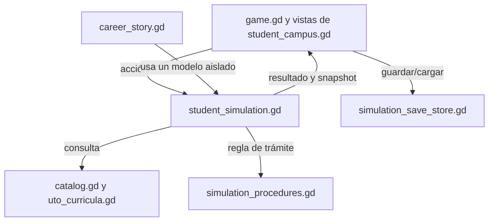

# Arquitectura

Revisada: 2 de noviembre de 2026. Código de referencia: `b122e96`.

Actualización local del 03/11/2026: terminal demostrativa independiente,
transiciones de exploración diferidas al terminar la entrada e icono pixel art.

La ampliación posterior del campus separa paisaje (`campus_landscape.gd`),
dibujo de terreno (`campus_terrain.gd`), índice de árboles (`campus_foliage.gd`),
arte procedural de monumentos y personajes, planos y fichas superpuestas.
El [contrato de campus ampliado](CAMPUS_AMPLIADO_Y_VIDA_DEL_CAMPUS.md) identifica
las señales y el trabajo de motor todavía pendiente, sin cambiar sus reglas.

## Alcance

El repositorio contiene tres componentes relacionados con la vida académica,
pero independientes en ejecución:

1. `game/`: juego de escritorio Godot y experiencia principal del proyecto.
2. `backend/`: API Django con almacenamiento PostgreSQL para el sistema
   académico.
3. `frontend/`: interfaz Next.js que consume endpoints de la API y contiene
   además una demostración web independiente.

Godot usa su propio modelo y partidas JSON en `user://`. No hace peticiones al
backend ni necesita ejecutar el frontend web. No cambiar reglas de API o datos
institucionales para resolver un cambio de presentación del juego.

## Raíz del repositorio

| Ruta | Responsabilidad |
|---|---|
| `AGENTS.md` | Instrucciones de trabajo obligatorias para agentes. |
| `REGLAS_USUARIO.txt` | Registro acumulativo que prevalece sobre documentación de análisis anterior. |
| `game/` | Proyecto Godot, recursos, escenas, scripts y pruebas del juego. |
| `backend/` | Configuración Django y aplicaciones del sistema académico. |
| `frontend/` | Aplicación Next.js y componentes de interfaz web. |
| `docs/` | Guías, especificaciones y documentos de coordinación. |
| `.env.example` | Valores de ejemplo para el desarrollo local; no contiene configuración de producción. |

Los archivos `.env`, cachés, dependencias descargadas y exportaciones locales
están excluidos del control de versiones mediante `.gitignore`.

## Juego Godot

La escena de inicio es `game/scenes/main.tscn`. El nodo principal usa
`game/scripts/game.gd`, que compone el menú, aplica preferencias y coordina la
navegación. El estado académico está separado de las vistas para evitar que la
interfaz invente resultados.

| Archivo o grupo | Responsabilidad |
|---|---|
| `game/scripts/game.gd` | Entrada de la escena, pantallas generales, navegación, opciones, tema, guardado y coordinación con los módulos de campus y simulación. |
| `game/scripts/student_simulation.gd` | Modelo de la partida. Controla elegibilidad, inscripción, inicio/cierre de periodo, respuestas, resultados, trámites, auxiliatura, graduación y `snapshot()`. |
| `game/scripts/student_campus.gd` | Construye las vistas de campus, materias, historial, trámites, auxiliatura, graduación y detalle del grafo a partir del modelo. Envía acciones al controlador. |
| `game/scripts/campus_map.gd`, `campus_world.gd`, `campus_exploration_ui.gd`, `campus_overview.gd` | Mapa de exploración FNI, movimiento con colisiones, interiores, menús y estado espacial separado del expediente académico. Véase [Exploración FNI](EXPLORACION_FNI.md). |
| `game/scripts/simulation_procedures.gd` | Define los pasos simulados de cada trámite. |
| `game/scripts/simulation_commands.gd` | Analiza comandos de la consola opcional y delega las acciones al modelo. |
| `game/scripts/simulation_save_store.gd` | Lee, guarda y elimina espacios de partida; encapsula los archivos y respaldos locales. |
| `game/scripts/achievement_catalog.gd` | Catálogo e identificadores de logros globales. |
| `game/scripts/catalog.gd`, `uto_curricula.gd` | Carreras, menciones, materias y datos curriculares usados por el juego. |
| `game/scripts/career_story.gd`, `career_story_ui.gd` | Motor y pantallas de la historia demostrativa. La historia usa la simulación sin ocupar una partida guardada. |
| `game/scripts/career_presentation.gd`, `career_presentation_view.gd` | Guion de orientación y terminal automática en bucle, de sólo lectura, con señal para animaciones laterales. Véase [Modo demostrativo](MODO_DEMOSTRATIVO.md). |
| `game/scripts/pixel_app_icon.gd`, `game/tools/prepare_pixel_icon.gd` | Dibujo compacto y generación reproducible de PNG/ICO para ejecutable y ventana. |
| `game/scripts/recreation_game.gd`, `chess_game.gd`, `pool_game.gd`, `pong_game.gd`, `campus_property_game.gd` | Motores recreativos locales, reglas, física y rivales, independientes del expediente académico. |
| `game/scripts/legacy_pool_game.gd` | Recupera sesiones anteriores de seis bolas; las nuevas usan ocho bolas. |
| `game/scripts/chess_piece_art.gd` | Siluetas propias de 32×40 para seis piezas, generadas una vez en dos colores. |
| `game/scripts/minigame_board.gd`, `minigame_session_ui.gd` | Controles, representación y sesiones de las cuatro mesas. Detalle en [Sala de juegos](JUEGOS_BLOQUE_E.md). |
| `game/scripts/curriculum_graph.gd`, `graph_routing.gd` | Dibujo, interacción, disposición y comprobación geométrica de los grafos curriculares. |
| `game/scripts/study_demo.gd`, `study_model.gd` | Controles didácticos y dibujos de demostración para las materias. |
| `game/scripts/neon_visuals.gd`, `mention_ambient.gd`, `mention_art.gd` | Paletas, efectos visuales y ambientes temáticos por mención. |
| `game/scripts/paged_view.gd`, `choice_picker.gd` | Paginación por botones y selección de opciones sin rueda ni deslizadores. |
| `game/scripts/menu_cave.gd`, `fracture_geometry.gd`, `fracture_animator.gd`, `broken_pixel_panel.gd` | Terminal interior, forma de los paneles rotos y reloj compartido de efectos. |
| `game/scripts/procedural_career_logo.gd`, `pixel_style_box.gd` | Emblema geométrico y estilos pixel art; no alteran el estado de una partida. |
| `game/tests/` | Pruebas automatizadas y capturas controladas del proyecto Godot. |

### Flujo de datos de una partida

Las llamadas habituales del modelo son `eligibility()`, `enroll()`,
`start_term()`, `answer()`, `close_term()`, `open_procedure()`,
`advance_procedure()`, `assistant_eligibility()`, `assistant_answer()`,
`defense_answer()` y `snapshot()`. Devuelven resultados que la capa de pantalla
presenta; las vistas no deben alterar directamente los estados para sortear
esas validaciones.

La navegación principal usa botones y páginas explícitas. La interfaz no debe
requerir rueda, barras de desplazamiento ni sliders; estas reglas están
detalladas en [`../REGLAS_USUARIO.txt`](../REGLAS_USUARIO.txt).

### Estado espacial y recreativo

El perfil mantiene `simulation`, `campus_exploration` y `minigames` como
campos separados. El primero pertenece al motor académico; el segundo conserva
posición, ambiente y visitas; el tercero almacena hasta cuatro sesiones de
minijuegos. Una victoria recreativa no cambia notas ni logros académicos.

Los motores de las mesas heredan el contrato de `recreation_game.gd`:
`command(action, expected_revision)` valida la acción y `advance(delta)`
actualiza física o rival. `serialize()` y `restore()` controlan la recuperación,
incluido el estado aleatorio de 64 bits como texto. La interfaz guarda en
cambios discretos y suspende sesiones al salir. Véase
[Sala de juegos](JUEGOS_BLOQUE_E.md).

## API Django

`backend/config/` contiene configuración, URLs y puntos de entrada ASGI/WSGI.
`backend/apps/` separa las áreas del dominio:

| Aplicación | Responsabilidad principal |
|---|---|
| `usuarios` | Usuario y roles institucionales. |
| `academico` | Carreras, planes, materias, prerrequisitos y periodos. |
| `oferta` | Aulas, docentes habilitados, paralelos y sesiones. |
| `inscripciones` | Inscripciones y reglas transaccionales de cupo y prerrequisitos. |
| `notas` | Actas, notas, cierre y correcciones auditadas. |

`backend/config/urls.py` conecta estos recursos bajo `/api/`; el detalle de
entidades y endpoints está en [`MODELO_DATOS.md`](MODELO_DATOS.md). La
configuración de desarrollo carga variables del `.env` de la raíz. El backend
usa PostgreSQL; no se asume una base SQLite ni una instancia compartida con el
juego.

## Interfaz web

`frontend/src/app/` contiene las rutas de Next.js. La ruta `/sistema` combina
catálogo, oferta, inscripciones y actas. `frontend/src/components/` contiene
esas pantallas y la demostración de juego web. `frontend/src/lib/api.ts`
centraliza solicitudes HTTP (por defecto a `http://localhost:8000`) y
`frontend/src/lib/juego-data.ts` mantiene datos de muestra de la demostración
web. Este contenido no es el catálogo Godot ni reemplaza las fuentes
institucionales.

## Datos institucionales

Los nombres de trámites, mallas y reglas que el juego presenta como simulación
no constituyen confirmación de normativa vigente. La lista de documentos
originales y verificaciones pendientes se mantiene en
[`PARA_BACKEND_DATOS_Y_FUENTES.txt`](PARA_BACKEND_DATOS_Y_FUENTES.txt).
