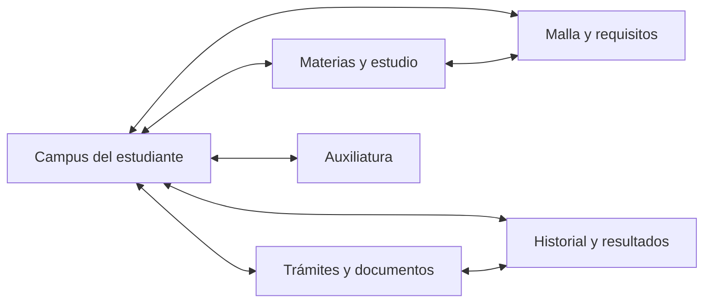

# Auditoría de frontend — CAMPUS EN JUEGO

Fecha: 24 de octubre de 2026.

## Alcance y evidencia

El producto principal confirmado por el usuario es el juego de escritorio Godot, `game/`. Se revisaron sus pantallas, navegación, presentación del progreso, malla, estudio, opciones y estados de guardado. Se inspeccionó también el frontend Next.js para distinguir las dos experiencias existentes, sin tratarlo como destino principal del rediseño.

Esta es una auditoría y propuesta de experiencia. No cambia pantallas, reglas de simulación, archivos de partidas ni código del backend. Las referencias de línea corresponden al código existente durante la revisión; pueden moverse con cambios posteriores.

El contexto consultado del chat de backend plantea una experiencia individual desde el estudiante: resultados mixtos por periodo, materias habilitadas por requisitos, trámites, cambios de carrera/mención, auxiliatura durante los estudios e historial. Allí todavía se estaba analizando el cambio. Esas funciones se describen aquí como objetivo, no como implementación disponible.

La inspección de código cubre `game.gd`, `catalog.gd`, `uto_curricula.gd`, `curriculum_graph.gd`, `study_demo.gd`, `mention_art.gd`, escena y configuración. Se intentó abrir y capturar el ejecutable existente. La ventana abrió, pero el servicio de captura devolvió `FrameArrived timed out` y `window capture timed out` tras recuperación. Por ello no se presenta una revisión visual manual de capturas como completada.

## Diagnóstico

La identidad visual está bastante desarrollada; la libertad funcional todavía es baja. La portada tiene cosmos, curvas, fórmulas y transiciones, pero el recorrido del jugador depende de capas sucesivas de menús y de un semestre completo antes del siguiente.

La sensación de interfaz «cuadrada» proviene principalmente de la composición repetida y de la separación entre actividades. Los paneles redondeados y el fondo animado ya aportan variedad de forma; el jugador necesita más continuidad, elección y consecuencias visibles.

Valoración orientativa de diseño, basada en la estructura y comportamiento del código, no en una prueba con usuarios:

| Aspecto | Valoración | Motivo |
|---|---|---|
| Movimiento de la portada | Alto | Fórmulas, curvas, partículas, citas y eventos cambian con el tiempo. |
| Rigidez de composición | Media-alta | Menú anclado, plantilla vertical repetida y varias distribuciones fijas. |
| Rigidez del recorrido | Alta, aproximadamente 8/10 | Creación por pasos, semestre cerrado por bloque y estudio repetido en tres parciales. |
| Libertad de exploración | Baja-media | Se eligen materias del bloque actual y se consulta la malla por páginas; faltan conexiones entre ambas acciones. |
| Adaptación a escritorio | Parcial | Hay ventana redimensionable, escala de texto y controles amplios; parte del layout se calcula solo al abrir la pantalla. |

## Qué conviene conservar

- Identidad propia de cuaderno y materiales académicos, con colores por carrera/materia.
- Portada científica y animada como entrada reconocible.
- Guardado por materia y tres espacios de partida.
- Malla con relaciones de prerrequisitos y detalle de materia.
- Botones con foco visible, Escape para volver, opciones de tamaño de texto y reducción de animaciones.
- Selección de materias dentro del bloque actual: es una base para ampliar la autonomía.
- Catálogo Godot ya centrado en Facultad de Ingeniería, Ingeniería de Sistemas e Ingeniería Informática, con sus menciones. Referencia: `catalog.gd:184–200,264–274`.

## Inventario y evaluación de interfaces

| Interfaz | Qué ofrece hoy | Evaluación y dirección propuesta |
|---|---|---|
| Inicio | Jugar, Opciones, Logros globales y Salir; fondo científico animado | Jerarquía sencilla. El menú permanece en la esquina superior izquierda, con ancho mínimo; no muestra la partida reciente ni una acción directa de continuar. Dar contexto de carrera, último avance y siguiente actividad. |
| Opciones | Pantalla completa, animaciones, antialiasing, bajo consumo y escala de texto | Buena base. Hace falta que todos los controles y dibujos respeten los ajustes y que la preferencia de ventana persista. |
| Logros globales | Lista acumulada entre partidas, con desplazamiento | Útil, pero duplica Volver/Atrás. Puede mostrar origen del logro y vínculo con el historial. |
| Selector de modos | Solo y Equipo local | Añade una decisión que pierde sentido con el objetivo de un único estudiante. Adaptarlo cuando se retire el modo equipo en el trabajo coordinado. |
| Partidas | Tres espacios por modo, Nueva/Continuar/Borrar y confirmación de borrado | Estructura entendible; falta resumen visual de progreso y estado fiable de guardado. Revisar la propiedad de ranura y perfil antes de ampliar esta interfaz. |
| Nombre | Campo de estudiante y continuar | Un paso completo para un único dato. El borrador debe conservarse al volver; Enter y foco inicial deberían permitir avanzar con teclado. |
| Facultad | Elección de Ingeniería | Al existir una sola facultad, añade una pantalla sin decisión efectiva. Integrar esta información en la selección de carrera. |
| Carrera | Sistemas o Informática, descripción y título | Alcance correcto. Conviene comparar de forma breve qué se explora en cada carrera y permitir consultar la malla antes de comprometer una partida. |
| Menciones | Tarjetas con ilustración, enfoque, proyecto de muestra y acciones | Contenido útil y más específico que la portada. La rejilla fija de dos columnas y la cantidad de texto requieren adaptación y desplazamiento. |
| Plan y recorrido | Nodos, conexiones y anterior/siguiente semestre | Comunica relaciones, pero se consulta separado del progreso. Necesita estados personales, apertura contextual y acceso a la actividad de la materia. |
| Detalle de materia/ingreso | Descripción, temas y prerrequisitos | Base informativa suficiente. Mostrar también estado, motivo del bloqueo, intentos e interacción disponible. Mantener detalle sincronizado con el semestre visible. |
| Hub estudiantil | Progreso, semestre activo, tarjetas de materias y acciones inferiores | Es el mejor punto para convertirse en centro de la experiencia. Actualmente muestra solo el primer semestre incompleto y obliga a navegar a otras pantallas para consultar contexto. |
| Estudio/parcial | Apunte, demo, pregunta, respuestas y ayuda «Chanchullo» | Dos columnas fijas y la misma estructura de tres parciales. Falta una actividad característica por tema, repaso libre y mejor continuidad entre explicación, interacción y respuesta. |
| Resultado | Mensaje y Continuar, con Atrás | Explica el resultado inmediato; debería representar además qué se habilitó, qué queda pendiente y qué opciones tiene ahora el estudiante. |
| Competencia | Examen habilitado al terminar la carrera | No cubre la auxiliatura durante la carrera solicitada en el nuevo objetivo. Su ubicación deberá consumir las nuevas condiciones del motor. |
| Final/títulos | Carrera completada y logros | Hoy completar materias entrega el título. La interfaz futura debe distinguir conclusión del plan, modalidad de graduación y titulación cuando esos estados existan en el motor. |
| Equipo y roles | Configuración de jugadores, turnos, casos, CV, entrevista, candidatura y gestión | Inventariados para conocer lo existente. Quedan fuera del objetivo individual indicado en el chat de backend; las oficinas pueden reaparecer como lugares de trámites del estudiante. |

Referencias principales de `game.gd`: inicio `1288–1343`; opciones `1423–1488`; modos/partidas `1491–1601`; creación/carrera/mención `1611–1726`; hub `1729–1847`; estudio `1850–1937`; resultados `1958–2066`; equipo/roles `2080–2437`; malla/detalle `2501–2590`. Logros `986–1009`; plantilla común `1012–1075`.

## Por qué el recorrido se siente fijo

### Entrada con demasiadas capas

El recorrido normal atraviesa Inicio → Jugar → Solo → Espacio → Nombre → Facultad → Carrera → Mención → Hub. Varias pantallas contienen una decisión pequeña o actualmente única. Cada navegación de menú puede añadir unos 0,82 segundos de transición (`game.gd:1377–1409`).

Propuesta: una entrada con Continuar y Nueva partida. La creación reúne nombre, carrera y mención, con vista previa de la malla y posibilidad de volver sin perder datos.

### Semestres cerrados como bloques

El hub busca el primer semestre con alguna materia no aprobada y muestra solamente ese grupo (`game.gd:1757–1795`). La disponibilidad no se presenta por requisito individual. Esto impide expresar un periodo con materias reprobadas de un semestre y nuevas materias habilitadas de otro.

El motor debe resolver la elegibilidad y las consecuencias. El frontend debe poder mostrar en una misma pantalla materias de distintos semestres, su estado y el motivo de cada bloqueo.

### Estudio con poca variedad de acciones

Cada materia repite tres parciales, pregunta de opciones, resultado y siguiente. Las materias aprobadas quedan deshabilitadas (`game.gd:1811`), por lo que no hay acceso de repaso desde su tarjeta.

Las materias sin un banco específico reciben preguntas generadas mediante plantillas muy similares (`catalog.gd:419–443`). La demo elige entre cuatro dibujos según palabras del nombre de la materia (`study_demo.gd:48–60`). Esto limita la sensación de estar probando actividades diferentes de una ingeniería.

Para una experiencia introductoria, conviene que cada familia tenga una interacción breve reconocible: ordenar un algoritmo, seguir datos por una red, depurar una condición, relacionar entidades o comparar recursos de un proceso. Es una propuesta de diseño, no contenido ya implementado.

### Malla informativa separada de la partida

El grafo abre siempre en el primer semestre y recibe carrera/mención, pero no estados personales (`curriculum_graph.gd:37–44`). Elegir un nodo muestra información; no conecta con estudiar, repasar o consultar un trámite.

La misma materia debería conservar identidad y estado en hub, malla, historial y estudio. Al abrir la malla desde una partida debería mantenerse el contexto de esa partida.

## Hallazgos funcionales y de presentación

### Prioridad alta: consistencia entre perfil y ranura

Estos dos recorridos se identifican por lectura de código; no se ejecutaron con partidas reales.

1. **Posible copia de una partida a otra ranura al cancelar una nueva.** `_begin_new_game()` cambia `active_slot` sin limpiar `current_profile` (`1562–1564`). Cargar A, comenzar B, cancelar y salir puede escribir el perfil A en B, porque `_save_profile()` usa la ranura activa (`2484–2493`).
2. **Posible reaparición de una partida borrada.** `_remove_slot()` elimina archivos, pero conserva el perfil cargado en memoria (`1591–1601`). Salir después llama al guardado (`2447–2449`) y puede recrearla.

Son problemas compartidos de persistencia y navegación. La solución debe coordinarse con quien separa el motor para que la interfaz no altere la ranura propietaria al trabajar en un borrador.

### Prioridad media: fallos verificables por código

| Hallazgo | Evidencia | Consecuencia |
|---|---|---|
| Pantalla completa se impone en cada arranque | `game.gd:149–156` después de `_load_settings()` | Se ignora la preferencia de ventana guardada. |
| Nombre se restablece a «Estudiante» al retroceder | `game.gd:1617,1623–1627` | Se pierde el borrador visible de creación. |
| «Cambiar carrera» abre las ranuras | `game.gd:1846` | El nombre de la acción no describe su destino ni implementa un cambio académico. |
| Slider de programación/datos/software no cambia el diagrama | `study_demo.gd:35–38,56–58,87–101` | El parámetro cambia, pero `_draw_steps()` no lo utiliza. |
| Malla solo tiene interacción por ratón | `curriculum_graph.gd:198–209` | Los nodos no ofrecen recorrido equivalente por teclado. |
| Escala de texto no llega al grafo ni a la demo | `curriculum_graph.gd:181–187`; `study_demo.gd:20,72,95` | Los textos dibujados siguen con tamaños fijos al aumentar la accesibilidad. |
| Desactivar animaciones no controla el grafo | `curriculum_graph.gd:25–34,138–176` | El movimiento de nodos continúa sin recibir el ajuste del juego. |
| Resize no reconstruye la distribución | `game.gd:840–842,1791,2515` | Columnas y anchura del grafo quedan calculadas según el tamaño con que se abrió la pantalla. |
| Detalle de materia permanece al cambiar de semestre | `curriculum_graph.gd:59–63`; `game.gd:2546–2547` | Puede aparecer información de una selección que ya no está visible. |
| Guardado no devuelve estado ni error a la UI | `game.gd:2484–2494` | «Guardar y salir» no puede confirmar al jugador que su progreso se conservó. |
| Logros duplica regreso | `game.gd:1006–1009,1064–1069` | Conviven Volver y Atrás con la misma función. |

### Distribución: mediciones confirmadas y pendientes visuales

Se ejecutó una sonda aislada que construye las pantallas con el motor en `SubViewport`, espera cinco frames y mide los rectángulos de sus controles. Fueron **52 casos**, con áreas lógicas de 900×640 y 1152×720 y texto al 100% y 120%. La sonda sustituye carga y persistencia por operaciones vacías y usa una partida ficticia, sin leer ni escribir partidas reales.

| Caso medido | Resultado |
|---|---|
| Examen de ambas carreras, 1152×720, texto 100% | La columna interna de `StudyDemo` mide 8 px de ancho; su etiqueta crece a 1251 px de alto y el deslizador queda en `y=1481`. Se reprodujo también en las demás combinaciones de examen. |
| Menciones de Sistemas, 1152×720, texto 120% | Atrás ocupa `y=746–788`, fuera del área de 720 px de alto. |
| Menciones de Sistemas, 900×640 lógico, texto 100% | Acciones de la tercera mención en `y=716–758`; Atrás en `y=785–827`. |
| Hub, 900×640 lógico, texto 100% | Acciones inferiores en `y=614–656` y Atrás en `y=671–713`. |
| Grafo, 900×640 lógico | Contenedor principal con 916 px de ancho; sus botones permanecen dentro del área. |
| Opciones, modos y partidas vacías | Controles dentro del área en las cuatro combinaciones medidas. Esto no prueba sus interacciones completas. |

Los 900×640 son una medida de **espacio lógico de UI**, no una reproducción afirmada de una ventana física de ese tamaño. El proyecto configura estiramiento `canvas_items/expand` con base 1152×720; la conversión entre píxeles de ventana y área lógica depende de ese ajuste. Los fallos de demo y menciones a 1152×720 ya se reproducen en el área base del proyecto.

La medición confirma geometría fuera del área, pero no evalúa contraste, composición de píxeles, animación ni recorrido de teclado. Artefactos locales: `.local-run/frontend-audit/layout_probe.gd`, `layout-results.json` y `godot-layout.log`.

Otras condiciones que merecen revisión visual:

- `_make_page()` crea una columna general sin desplazamiento (`game.gd:1012–1075`). Solo la lista de logros añade un `ScrollContainer` propio. El contenido de menciones, detalle y estudio puede superar el alto disponible.
- El examen usa dos columnas horizontales permanentes (`1910–1929`). Los botones genéricos no configuran ajuste multilínea de sus opciones (`1099–1108`). Respuestas largas y texto al 120% pueden forzar ancho.
- Menciones conserva dos columnas e ilustraciones de tamaño definido (`1672–1699`, `mention_art.gd:10`).
- La demo crea su columna interna sin anclajes de relleno y dibuja desde `y=54` fijo (`study_demo.gd:14–30,45`). Hay riesgo de desalineación cuando la etiqueta crece.
- La malla impone un ancho mínimo de 500 y el panel de detalle al menos 280 (`curriculum_graph.gd:40`; `game.gd:2533`). Esto deja poco margen a 900 de ancho con separación y bordes.
- El cambio de escala por teclado guarda el valor, pero reconstruir opciones está asociado a `drag_ended` (`game.gd:1444–1445,1481–1488`). Verificar aplicación inmediata con teclado.

## Propuesta de experiencia para Sistemas e Informática

### Un centro estudiantil persistente

Al continuar una partida, entrar al campus del estudiante con accesos disponibles en paralelo:

- **Mis materias:** cursando, habilitadas, pendientes y aprobadas; filtros y acceso a estudio/repaso.
- **Malla:** relaciones, estados personales y razones de bloqueo.
- **Trámites:** solicitudes, requisitos, documentos, oficina y siguiente paso.
- **Historial:** intentos y resultados por periodo, con sus consecuencias.
- **Auxiliatura:** requisitos y postulaciones disponibles durante la carrera.
- **Objetivos:** actividades sugeridas y avances recientes.

La navegación principal permanece visible al pasar entre esos espacios. Los resultados ofrecen acciones contextualizadas: volver a estudiar, ver lo habilitado, revisar pendientes o continuar un proceso.

### Libertad con contexto visible

Mostrar siempre qué puede hacer el estudiante y qué le falta para otra actividad. Una materia bloqueada sigue siendo consultable y explica sus requisitos. La malla curricular y el periodo de la partida son datos diferentes: el frontend no debe asumir que todas las materias cursadas pertenecen al mismo semestre de la malla.

Los trámites pueden representarse mediante pasos conectados, cada uno con requisitos, documentos y estados. La interfaz debe permitir consultar varias actividades abiertas y regresar a ellas conservando su contexto.

### Identidad temática más específica

La portada actual comunica ciencia y astronomía. Para acercarla a estas dos ingenierías, puede incorporar relaciones de sistemas, flujo de datos, redes, algoritmos y decisiones sobre recursos, además de las matemáticas existentes. Usar estas imágenes para explicar una actividad o un avance ayudaría a conectar portada y experiencia interior.

La base de escritorio debe adaptar cantidad de columnas y paneles al espacio disponible. El ajuste de texto debe alcanzar etiquetas, respuestas, grafo y demostraciones. Priorizar primero continuidad, lectura e interacción; los efectos acompañan esos cambios.

## Coordinación con motor/backend

El juego actual es local y no consume la API Django. La separación requerida puede hacerse con un adaptador local; esta revisión no propone introducir HTTP ni convertir el juego en una web.

`game.gd` mezcla presentación, navegación, guardado y reglas. Las zonas con mayor riesgo de edición simultánea son: partidas `1562–1601`; hub `1729–1847`; estudio `1850–1937`; resultados `1958–2031`; guardado `2460–2494`.

El contrato de presentación debería entregar datos explícitos:

| Área | Datos necesarios para la interfaz |
|---|---|
| Partida | ID, ranura propietaria, carrera, mención y versión del esquema. |
| Periodo | Periodo actual y lista de materias cursadas/habilitadas, independiente del semestre curricular. |
| Materia | ID, nombre, estado, avance, requisitos, bloqueos explicados y acciones disponibles. |
| Estudio | Intento, actividad, parciales completados/total, opciones identificables y explicación. |
| Trámite | Tipo, estado, pasos, requisitos cumplidos/faltantes, documentos y siguiente acción. |
| Historial | Intento, periodo, resultado y efectos conservados. |
| Auxiliatura | Elegibilidad, convocatoria, postulación, evaluación y designación. |
| Guardado | Pendiente/guardando/guardado/error y una acción de recuperación. |

Los estados se definen una vez en el motor; la UI muestra sus valores y conserva únicamente selección, navegación y borradores. Los totales de parciales y las acciones disponibles deben venir de ese contrato, en lugar de repetir el literal `3` o calcular elegibilidad dentro de los controles.

Para notas temporales de integración, usar una marca reconocible como `FRONTEND-PENDIENTE`, con dato disponible, acción que debe mostrar la UI y condición de habilitación. Consumir la nota al implementar y verificar el comportamiento correspondiente. No se encontraron notas de este tipo en el código al comenzar la auditoría. No se elimina ni aplica un comentario de otro colaborador durante esta revisión.

## Orden propuesto de trabajo

1. Coordinar la separación motor/UI y corregir propiedad de partidas/ranuras y estados de guardado.
2. Reorganizar entrada y hub para una experiencia individual de estudiante, con borradores persistentes.
3. Integrar estados de materias del nuevo motor en hub, malla e historial.
4. Incorporar trámites y auxiliatura como actividades del estudiante cuando estén disponibles sus contratos.
5. Variar actividades de estudio y conectar las demostraciones con parámetros que expliquen consecuencias.
6. Completar adaptación a ventanas, texto aumentado, teclado y reducción de movimiento; revisar visualmente los recorridos completos.

## Referencia secundaria: frontend web

Next.js contiene dos rutas: `/` carga un simulador en `juego-academico.tsx`, mientras `/sistema` apila catálogo, oferta, inscripciones y actas. No son la interfaz del ejecutable CAMPUS EN JUEGO.

La versión web del juego conserva seis carreras, cuatro capítulos lineales, roles superiores y guardado en `localStorage`; está menos alineada con el nuevo enfoque. El sistema académico web tiene datos de API y formularios, pero navegación larga por anclas, tipografías pequeñas y poca comparación previa a inscribirse. Se detectaron además riesgos de borradores de notas y oferta antigua tras cambiar de periodo.

Estos hallazgos quedan como referencia del inventario. No se recomienda trasladar automáticamente los flujos web a Godot ni ampliar su desarrollo mientras el destino confirmado siga siendo el juego de escritorio.

## Verificación y pendientes

- Inspección estática de todas las familias de pantallas Godot y del frontend web realizada.
- `npm run build` completado: compilación, tipos y exportación estática de `/` y `/sistema` correctos; advertencias de caché de webpack durante el proceso. Esto verifica la base web secundaria, no la jugabilidad Godot.
- Godot `--headless --editor --quit` terminó con código 0 sin errores de parseo reportados. El entorno emitió errores al consultar certificados y al intentar guardar preferencias del editor fuera del espacio permitido; esto limita considerar el arranque del editor completamente limpio.
- Captura visual del ejecutable bloqueada por errores del servicio de captura; no se validaron mediante capturas los posibles recortes, el contraste ni el recorrido de teclado.
- No se ejecutaron operaciones sobre partidas reales ni trámites ni cambios académicos.
- Los defectos de persistencia se describen como recorridos posibles por inspección; requieren reproducción posterior con datos desechables.
- Sonda aislada de layout completada: 52 casos. Confirmó desbordamientos en los escenarios descritos y el colapso de la columna de la demo. Sin errores de scripts/parseo; se registró el aviso del almacén de certificados de Windows y un aviso de anchors de la propia sonda.
