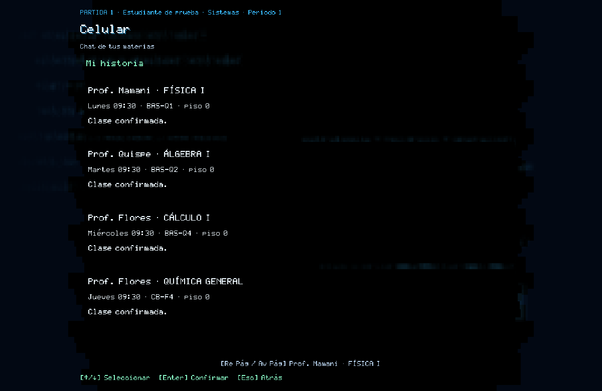
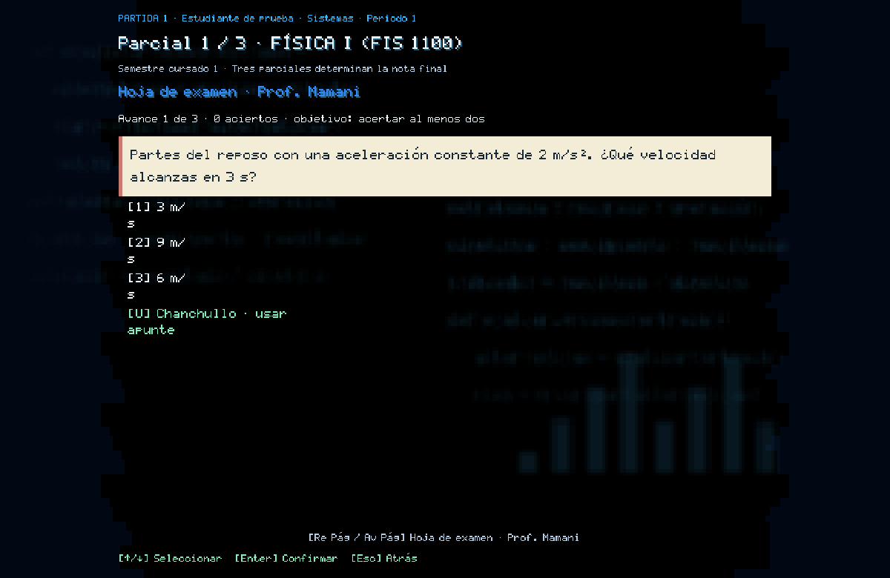
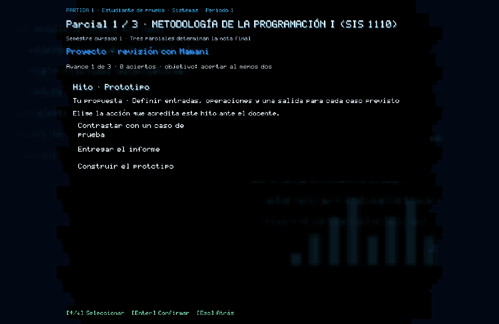

# Guía y rutina estudiantil

## Cómo jugar

- En el campus, pulsa **G** para abrir la guía. Al marcar un destino se
  resalta su ubicación en el mapa. La marca sigue visible al llegar al
  exterior del edificio o puesto.
- Entra a **Decanato**, acércate al mostrador y pulsa **E** para iniciar o
  continuar trámites. Cada expediente muestra el paso actual, sus documentos
  y las acciones de esa ventanilla. Caja, Kardex y las demás etapas son parte
  del recorrido simulado del expediente.
- En **Dirección de Carrera**, en el edificio de Administración de Sistemas,
  consulta Auxiliaturas, postula y abre las carpetas de la convocatoria o del
  trabajo asignado.
- Pulsa **H** en el recorrido para abrir el horario o consulta una pizarra de **Ciclo Básico**.
  El horario de tus inscripciones indica el día, la franja, el aula y el piso.
  En la pizarra pulsa **E**. Si la clase todavía no comenzó, puedes esperar en
  el aula. El reloj y las necesidades avanzan durante esa espera. Al terminar la explicación puedes conservar el apunte en la mochila.
- Acércate a un puesto y pulsa **E** para comprar. Con **Tab** abres o cierras la mochila. Puedes
  cambiar entre **Alimentos**, **Carpetas** y **Apuntes** con **1–3** o **←/→**.
  Selecciona alimentos con **↑/↓** y consúmelos con **Enter**.
  El comedor y el kiosco están dentro del campus. Encuentra el pollo, el café
  espumoso, la tienda con licor y el camión de milanesas por el ingreso exterior.

## Teclas según la pantalla

| Pantalla | Teclas |
|---|---|
| Recorrido | WASD o flechas para moverte, Shift para correr, E para interactuar, J para la misión actual, C para el celular, H para el horario, G para destinos, M para el mapa y F1 para los controles. |
| Mochila | Tab para abrir desde el mundo, la pausa, el mapa o un puesto. Tab o Esc devuelve a la pantalla desde la que entraste. |
| Pausa y pantallas académicas | Esc pausa o regresa. F2–F5 abre los accesos anunciados en el campus. En las listas, ↑/↓ permite seleccionar, Enter confirma y Re Pág/Av Pág recorre el contenido extenso. |
| Formularios | Tab y Mayús+Tab recorren campos. Los atajos de juego ceden mientras escribes. |
| Mapas y grafos | Flechas y teclas indicadas en el lienzo. +/− y la rueda ajustan el zoom. |

## Reglas del juego

El saldo inicial y la asignación por semana simulada son de 100 créditos.
La mochila tiene 12 espacios para consumibles y conserva aparte documentos
y apuntes. Hay agua sin costo. El hambre y la sed crecen con el tiempo
jugable y reducen un poco la velocidad al alcanzar un nivel alto. El licor
es un producto recreado sin efecto de hidratación. Los precios, horarios,
contenidos de pizarra y ubicaciones de puestos son valores del juego.

El reloj, la mochila y las necesidades se guardan con la exploración de cada
partida. Una partida antigua inicializa estos datos al retomar el recorrido.
Las visitas libres conservan su estado durante la sesión.

## De la matrícula a la graduación

1. Sigue el objetivo en pantalla hasta Decanato. En el mostrador, abre la carpeta de matrícula, consigue los comprobantes indicados y completa sus pasos. Inicia el semestre con **J** cuando tu matrícula esté vigente.
2. Abre el horario con **H**. En el primer semestre recibes las materias de ingreso con franjas distintas. Desde el segundo, revisa los choques antes de empezar y usa **Cambiar paralelo** para probar otro grupo.
3. Consulta el celular con **C**. El chat indica la hora efectiva, el piso y el aula. Si un docente avisa que llegará tarde, cancela la clase o traslada el examen, el aula sigue el mismo calendario. El minimapa del recorrido indica tu posición y el destino. Con **G** puedes marcar un puesto para hacer una parada.
4. En la pizarra, pulsa **E** para asistir o esperar. Puedes resolver una tarea clasificando un apunte de la materia. Para un examen, espera a la fecha anunciada y responde en la hoja. Cada acierto cuenta para la nota. En una materia con proyecto, prepara una propuesta y acredita el hito correspondiente: prototipo, pruebas y entrega. Los avances se presentan en sesiones distintas.
5. Cierra el semestre cuando estén todas las notas. En **C → Mi historia** puedes leer qué aprobaste, qué debes recursar y las auxiliaturas que ganaste. Al completar el plan, sigue la misión de titulación. La excelencia exige promedio mayor de 65 y ninguna reprobación.

### El personaje y la mochila

Consulta tu rasgo en la mochila. Con miopía debes ponerte lentes para leer la pizarra y rendir. Puedes comprarlos en la tienda o pedirlos prestados en el aula. Con cabeza de pollo puedes copiar el apunte a mano o equipar una agenda. El kiosco vende leche sin lactosa para quien la necesite. Compra el equipo en la tienda exterior y actívalo desde la mochila.

| Celular y avisos | Hoja de examen | Revisión de proyecto |
|---|---|---|
|  |  |  |

En **H → Talleres abiertos** encontrarás doce prácticas optativas en Básicas y el Bloque 100. Cada ficha indica el día, el aula y el piso. Puedes esperar la sesión en su pizarra y guardar el apunte. Estos talleres recreados permiten practicar durante la exploración libre y durante una partida.

En el minimapa, la flecha blanca te ubica y la marca dorada señala tu destino. El mapa grande se abre con **M**.

## Fuentes pendientes

Para sustituir la recreación hacen falta horarios o listados de aulas por
materia y paralelo, temarios o apuntes autorizados, formularios y orden de
oficinas vigentes, y un croquis o fotos propias de los puestos con permiso
de uso. Consultar el [registro de fuentes](PARA_BACKEND_DATOS_Y_FUENTES.txt).

## Capturas de comprobación

Godot 4.7.2 en Windows. Partida ficticia de Sistemas, vista lógica de
1200 × 780. Las parejas muestran el mismo aula y los apuntes de Física I
antes y después de aplicar los atajos contextuales.

| Pantalla | Antes | Después |
|---|---|---|
| Aula en Ciclo Básico | [Botonera del recorrido](evidencia/teclado/aula-antes.png) | [Indicaciones de interacción, misión y pausa](evidencia/teclado/aula-despues.png) |
| Mochila | [Inventario, carpetas y apuntes en una vista](evidencia/teclado/mochila-antes.png) | [Apuntes en su bolsillo, seleccionable mediante 3 o flechas](evidencia/teclado/mochila-despues.png) |
